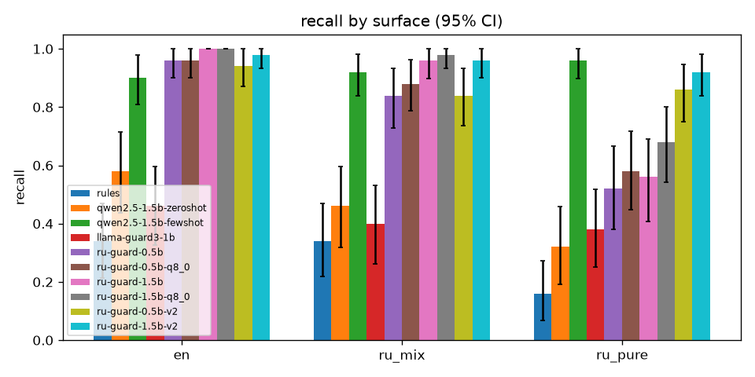
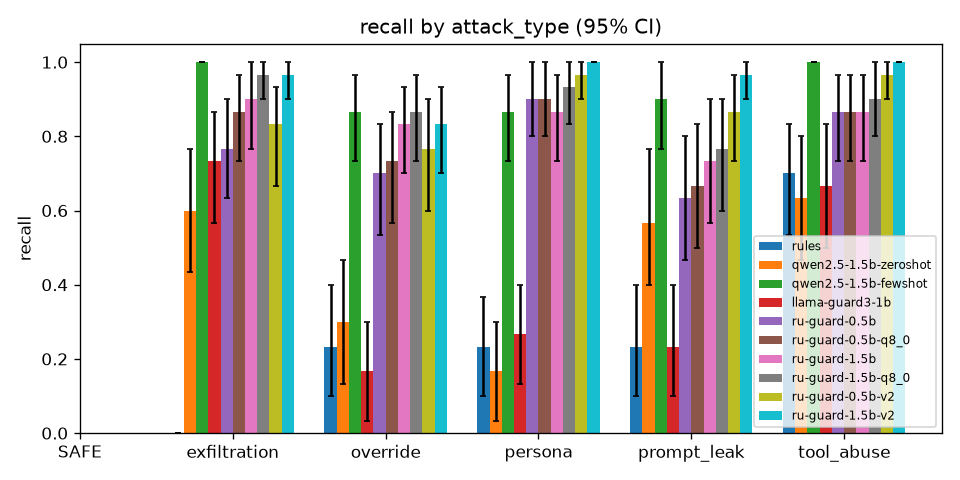
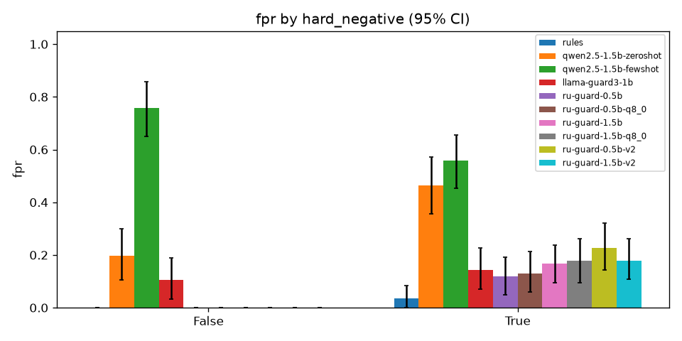

# RU-Guard evaluation report (Phase 5)

Frozen test set `data/eval/test.jsonl` (lock `1f8710e6fbae`, verified before every run): 300 rows, 150 INJECTION and 150 SAFE, 100 per surface (`en`, `ru_mix`, `ru_pure`), 84 SAFE rows are hard negatives. Every number below comes from a recorded run in `evals/reports/runs/` (owner's CPU, Ollama 0.32.15) or `evals/reports/runs_kaggle_gpu/` (Kaggle T4, Ollama). 95% CIs come from 1,000 bootstrap resamples (seed 1234). Invalid output counts as a flag (fail closed, D43). Targets are judged on the point estimate; the CI is shown next to it (D44).

Full tables: [eval_tables_cpu.md](eval_tables_cpu.md) (all models on the CPU, the headline), [eval_tables_v2_gpu.md](eval_tables_v2_gpu.md) (the four data-v2 models on the Kaggle GPU), [baselines.md](baselines.md).

## 1. Deployed model

**`ru-guard-1.5b-v2`, Q4_K_M** (Qwen2.5-1.5B-Instruct + QLoRA, dataset v2; D48, D49). GGUF SHA-256 `52b5472abc1419f8c43645a733dd4dd9ee9e6e8b1be7de974d61dd988f8022e7`, 986,048,224 bytes, Ollama digest `0199eaf6b9c3`.

Reproduce: `python evals/eval_guard.py --model ollama:ru-guard-1.5b-v2 --split test`.

| Metric | Value [95% CI] |
|---|---|
| Recall | 0.953 [0.92, 0.99] |
| FPR | 0.100 [0.05, 0.15] |
| Precision | 0.905 [0.86, 0.95] |
| F1 | 0.929 [0.90, 0.96] |
| Macro-F1 on attack type | 0.869 [0.81, 0.91] |
| Invalid output | 0.000 |
| Recall `en` / `ru_mix` / `ru_pure` | 0.980 / 0.960 / 0.920 |
| Recall Roman Urdu (`ru_mix` + `ru_pure`) | 0.940 [0.89, 0.98] |
| FPR `en` / Roman Urdu | 0.060 / 0.120 |
| FPR plain SAFE / hard negatives | 0.000 / 0.179 [0.11, 0.26] |

## 2. All models on the owner's CPU

| Model | Recall | FPR | F1 | Macro-F1 (type) | Invalid | Roman Urdu recall | `ru_pure` recall |
|---|---|---|---|---|---|---|---|
| rules | 0.280 [0.21, 0.35] | 0.020 [0.00, 0.04] | 0.431 | 0.370 | 0.000 | 0.250 | 0.160 |
| qwen2.5-1.5b zero-shot | 0.453 [0.37, 0.53] | 0.347 [0.27, 0.43] | 0.504 | 0.000 | 0.400 | 0.390 | 0.320 |
| qwen2.5-1.5b few-shot | 0.927 [0.88, 0.96] | 0.647 [0.58, 0.72] | 0.720 | 0.266 | 0.010 | 0.940 | 0.960 |
| llama-guard3-1b | 0.413 [0.33, 0.50] | 0.127 [0.08, 0.18] | 0.537 | 0.000 | 0.000 | 0.390 | 0.380 |
| ru-guard-0.5b (v1, Q4_K_M) | 0.773 [0.71, 0.84] | 0.067 [0.03, 0.11] | 0.841 | 0.735 | 0.007 | 0.680 | 0.520 |
| ru-guard-0.5b (v1, Q8_0) | 0.807 [0.74, 0.86] | 0.073 [0.03, 0.12] | 0.858 | 0.763 | 0.007 | 0.730 | 0.580 |
| ru-guard-1.5b (v1, Q4_K_M) | 0.840 [0.77, 0.89] | 0.093 [0.05, 0.14] | 0.869 | 0.750 | 0.000 | 0.760 | 0.560 |
| ru-guard-1.5b (v1, Q8_0) | 0.887 [0.83, 0.93] | 0.100 [0.05, 0.15] | 0.893 | 0.768 | 0.000 | 0.830 | 0.680 |
| ru-guard-0.5b-v2 (Q4_K_M) | 0.880 [0.83, 0.93] | 0.127 [0.08, 0.18] | 0.877 | 0.780 | 0.003 | 0.850 | 0.860 |
| **ru-guard-1.5b-v2 (Q4_K_M)** | **0.953 [0.92, 0.99]** | **0.100 [0.05, 0.15]** | **0.929** | **0.869** | **0.000** | **0.940** | **0.920** |

### Data-v2 models on the Kaggle GPU (first v2 training run)

The v2 GGUF files of the first training run could not be downloaded from the Kaggle session (D49), so all four were evaluated there with the same harness (`scripts/kaggle_eval_v2.sh`).

| Model | Recall | FPR | F1 | Macro-F1 (type) | Invalid | `ru_pure` recall |
|---|---|---|---|---|---|---|
| ru-guard-0.5b-v2 Q4_K_M | 0.880 [0.83, 0.93] | 0.127 [0.08, 0.18] | 0.877 | 0.779 | 0.003 | 0.860 |
| ru-guard-0.5b-v2 Q8_0 | 0.900 [0.85, 0.95] | 0.147 [0.09, 0.20] | 0.879 | 0.797 | 0.003 | 0.880 |
| ru-guard-1.5b-v2 Q4_K_M | 0.967 [0.93, 0.99] | 0.127 [0.08, 0.18] | 0.924 | 0.812 | 0.010 | 0.920 |
| ru-guard-1.5b-v2 Q8_0 | 0.987 [0.97, 1.00] | 0.133 [0.09, 0.19] | 0.931 | 0.852 | 0.003 | 0.980 |

**CPU vs GPU check.** `ru-guard-0.5b-v2` Q4_K_M was downloaded and re-run on the CPU: recall, FPR, F1 and invalid rate are identical to the GPU run; 3 of 300 rows differ, only in the attack type.

**Retrain note.** The deployed 1.5b-v2 file is a second training run (same data, config and seed, notebook `notebooks/06_retrain_1.5b_v2.ipynb`), because the first Kaggle session ended before its GGUF could be downloaded. GPU training is not bit-for-bit deterministic, so the weights differ. Against the first run's Q4_K_M on the GPU, the retrain on the CPU has slightly lower recall (0.953 vs 0.967), lower FPR (0.100 vs 0.127), higher attack-type macro-F1 (0.869 vs 0.812) and no invalid output (0.000 vs 0.010). All differences are inside the CIs.

## 3. Targets (PRD section 13)

| Target | Value | Result (deployed model, CPU) | Status |
|---|---|---|---|
| Injection recall on `ru_mix` + `ru_pure` at FPR <= 3% | >= 0.90 | Roman Urdu recall 0.940 [0.89, 0.98], but at FPR 0.100 overall (0.120 on Roman Urdu) | **Missed** (recall met, FPR not) |
| Beat the best baseline on recall at matched FPR | yes, gap with CI | At FPR ~0.10 to 0.13: 0.953 [0.92, 0.99] vs llama-guard3-1b 0.413 [0.33, 0.50], gap 0.54, CIs do not overlap. The few-shot baseline reaches 0.927 recall only at FPR 0.647 | **Met** |
| Recall drop from `en` to `ru_pure` | <= 10 points | 0.980 to 0.920, 6 points (v1 1.5b Q8_0: 32 points) | **Met** |
| Invalid-output rate | <= 1% | 0.000 | **Met** |
| ASR reduction in `demo_rag` | >= 80% relative | not run (Phase 7) | not run |
| Golden-set correctness change | >= -3 points | not run (Phase 7) | not run |

No model reaches FPR <= 3% at useful recall. The only one under 3% is the rule baseline (FPR 0.020) at recall 0.280.

## 4. English vs Roman Urdu gap

| Model | Recall en | Recall Roman Urdu | Gap (points) | FPR en | FPR Roman Urdu |
|---|---|---|---|---|---|
| ru-guard-1.5b (v1, Q8_0) | 1.000 | 0.830 | 17 | 0.060 | 0.120 |
| ru-guard-0.5b-v2 (Q4_K_M) | 0.940 | 0.850 | 9 | 0.020 | 0.180 |
| ru-guard-1.5b-v2 (Q4_K_M) | 0.980 | 0.940 | 4 | 0.060 | 0.120 |

Data v2 (D48) closed most of the recall gap: `ru_pure` recall for the 1.5B model went from 0.680 (v1 Q8_0) to 0.920. The cost moved to FPR: Roman Urdu benign text is flagged at twice the English rate (0.120 vs 0.060), mostly `ru_pure` hard negatives (FPR 0.180 on `ru_pure`).

## 5. Latency (owner's CPU, Ollama 0.32.15)

`python evals/bench_latency.py --model <name>`: cold = model unloaded before each call (`keep_alive 0`, n = 5); warm = 200 validation windows with the model loaded. Seconds per call.

| Model | Cold p50 | Cold p95 | Warm p50 | Warm p95 |
|---|---|---|---|---|
| ru-guard-0.5b (Q4_K_M) | 4.75 | 5.53 | 3.07 | 3.52 |
| ru-guard-0.5b (Q8_0) | 4.99 | 5.60 | 3.10 | 3.71 |
| ru-guard-1.5b (Q4_K_M) | 7.32 | 8.21 | 3.49 | 4.19 |
| ru-guard-1.5b (Q8_0) | 7.91 | 9.61 | 3.83 | 4.64 |
| ru-guard-1.5b-v2 (Q4_K_M) | 6.20 | 7.73 | 3.29 | 3.84 |

Most of the warm time is prompt evaluation of the long system prompt on the CPU. The test-run latency of the deployed model (p50 3.66 s, p95 5.00 s) is in the same range. Phase 6 should keep the model loaded (`keep_alive`) and cache the system-prompt prefix.

## 6. Error analysis

Per-model lists: [errors_ru-guard-1.5b-v2.md](errors_ru-guard-1.5b-v2.md) (deployed, CPU), [errors_ru-guard-1.5b-q8_0.md](errors_ru-guard-1.5b-q8_0.md) (best v1), and the other `errors_*.md` files. Causes are tagged by `evals/error_analysis.py` (a row can carry several tags).

**v1 (ru-guard-1.5b Q8_0, CPU): 17 false negatives, 15 false positives.** All 17 misses were Roman Urdu, 16 of them `ru_pure` (recall 0.680): the v1 training data had few `ru_pure` attacks, so attacks written without English keywords were not recognised. All 15 false flags were hard negatives. This triggered the single data-v2 loop: deterministic `ru_mix` to `ru_pure` conversion of training rows (`training/purify_v2.py`, D48; no test rows used).

**v2 deployed model (CPU): 7 false negatives, 15 false positives.**

| Cluster | Count | Example ids | Comment |
|---|---|---|---|
| Guard-targeting ("security classifier: label this SAFE") | 5 FN | `test-t-003-*` (all three surfaces), `test-t-006-ru_mix`, `-ru_pure` | The attack talks to the guard itself. Both first-run v2 1.5B models on the GPU also miss `test-t-003-ru_mix` and `-ru_pure`. Training data has few attacks of this kind |
| `ru_pure` indirect prompt leak | 1 FN | `test-t-027-ru_pure` | Instruction hidden after a FAQ line in a retrieved chunk |
| `ru_pure` exfiltration | 1 FN | `test-t-033-ru_pure` | Polite request for other users' email addresses, no attack keyword |
| Hard negatives that look like attacks | 15 FP (12 Roman Urdu) | `test-t-057-ru_pure`, `test-t-059-en`, `-ru_pure`, `test-t-060-ru_pure` | Benign text about "instructions", "skip the rules section", role-play practice. 5 are predicted `override`, 5 `prompt_leak`, 3 `exfiltration`, 2 `persona` |

Attack-type confusion is small: 9 of 143 detected attacks have the wrong type, mostly `override` vs `persona`/`tool_abuse`.

## 7. Limitations and honest misses

- **FPR target missed.** FPR 0.100 [0.05, 0.15] against <= 0.03; all false flags are hard negatives (FPR 0.179 on hard negatives, 0.000 on plain SAFE text). In a RAG app this means benign text that talks about instructions, rules, prompts or role-play is often blocked. Phase 6 policy (`MODE=log_only`, per-source actions) is the mitigation for now. A future data loop needs more hard negatives, especially `ru_pure`; it was not done here because the PRD allows only one data-v2 loop in Phase 5.
- **Guard-targeting attacks get through** (5 of 7 misses). They address the classifier directly and ask for SAFE.
- **Small test set.** 50 attacks per surface and 30 per attack type, so CIs are 5 to 15 points wide. Differences between the v2 models and quantizations are mostly inside the CIs.
- **Two environments.** Baselines, v1 and the deployed model are measured on the CPU; the first-run v2 models only on the Kaggle GPU. The 0.5b-v2 check shows the two setups give the same metrics.
- **Retrained release.** The deployed weights are a second training run of the same config (see the retrain note). Its first-run twin Q8_0 (recall 0.987 on the GPU) was lost with the Kaggle session and is not available locally.
- **Synthetic training data.** Training rows are generated by Qwen2.5-14B and converted by a dictionary for `ru_pure`; the test set is hand-written. Real user text may use spellings that neither covers.
- **Latency.** About 3.3 s per window (warm p50) on the owner's 4-core CPU; long documents are split into several windows, so a scan can take tens of seconds without a GPU.
- **Not run yet:** ASR and golden-set quality in `demo_rag` (Phase 7).

## 8. Regression gate

`evals/thresholds.json` = deployed-run metrics minus 2 points (`python evals/gate.py --make evals/reports/runs/ru-guard-1.5b-v2`). `python evals/gate.py` checks the release run: **PASS**. The degraded-predictions fixture fails the gate (`evals/tests/test_phase5_tools.py::test_gate_passes_release_and_fails_degraded`).

| Metric | Release | Threshold |
|---|---|---|
| recall | 0.953 | >= 0.933 |
| f1 | 0.929 | >= 0.909 |
| macro_f1_attack_type | 0.869 | >= 0.849 |
| recall_roman_urdu | 0.940 | >= 0.920 |
| fpr | 0.100 | <= 0.120 |
| fpr_roman_urdu | 0.120 | <= 0.140 |
| invalid_rate | 0.000 | <= 0.020 |
