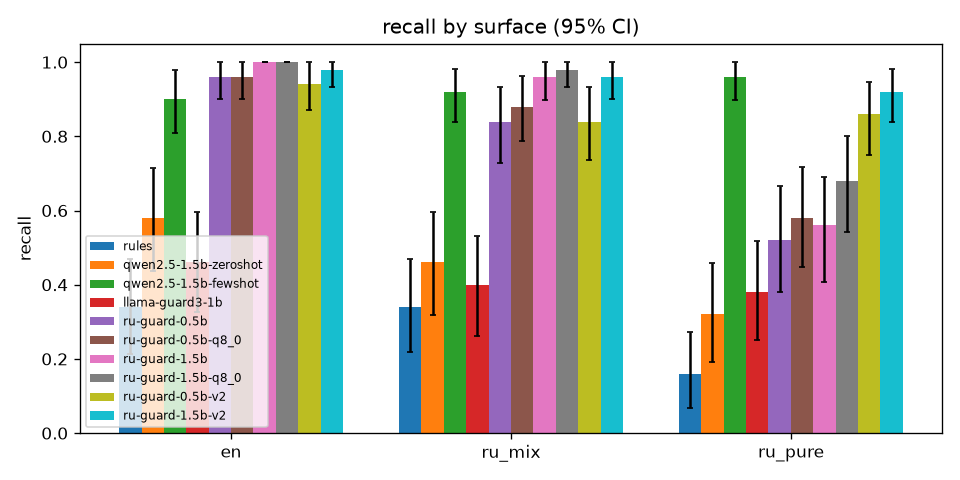
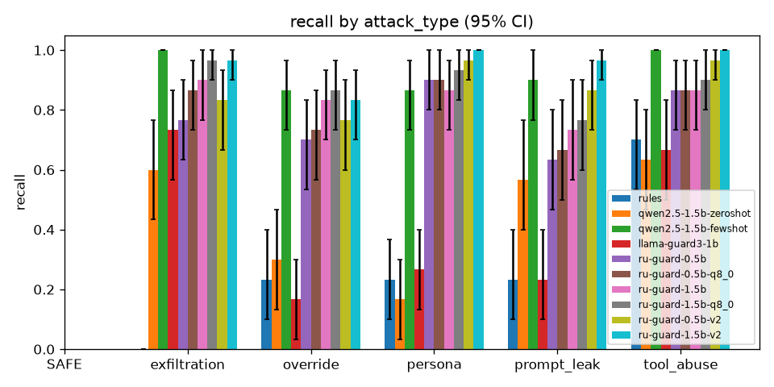
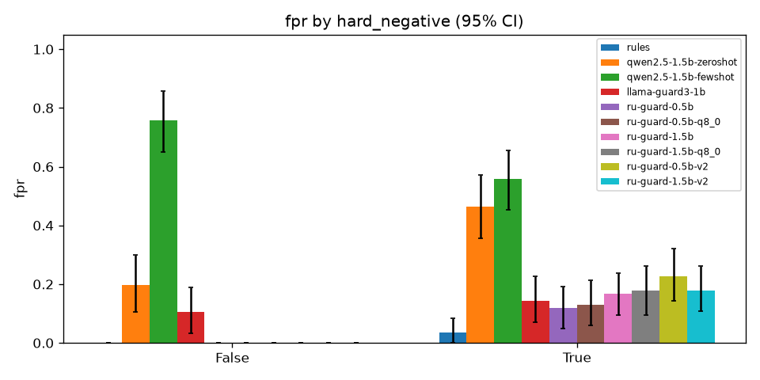

# Test set results, owner's CPU (Ollama 0.32.15)

Test set: 300 rows (150 INJECTION, 150 SAFE; 100 per surface). 95% CIs from 1,000 bootstrap resamples (seed 1234). Invalid outputs count as flags (fail closed, D43).

## Overall

| Model | Recall | FPR | Precision | F1 | Macro-F1 (attack type) | Invalid | p50 s | p95 s |
|---|---|---|---|---|---|---|---|---|
| rules | 0.280 [0.21, 0.35] | 0.020 [0.00, 0.04] | 0.933 [0.85, 1.00] | 0.431 [0.35, 0.51] | 0.370 [0.30, 0.43] | 0.000 | 0.000 | 0.000 |
| qwen2.5-1.5b-zeroshot | 0.453 [0.37, 0.53] | 0.347 [0.27, 0.43] | 0.567 [0.48, 0.65] | 0.504 [0.43, 0.57] | 0.000 [0.00, 0.00] | 0.400 | 3.372 | 3.833 |
| qwen2.5-1.5b-fewshot | 0.927 [0.88, 0.96] | 0.647 [0.58, 0.72] | 0.589 [0.52, 0.65] | 0.720 [0.66, 0.77] | 0.266 [0.20, 0.33] | 0.010 | 3.656 | 4.449 |
| llama-guard3-1b | 0.413 [0.33, 0.50] | 0.127 [0.08, 0.18] | 0.765 [0.67, 0.85] | 0.537 [0.45, 0.61] | 0.000 [0.00, 0.00] | 0.000 | 4.157 | 4.660 |
| ru-guard-0.5b | 0.773 [0.71, 0.84] | 0.067 [0.03, 0.11] | 0.921 [0.87, 0.97] | 0.841 [0.79, 0.89] | 0.735 [0.66, 0.79] | 0.007 | 2.983 | 3.783 |
| ru-guard-0.5b-q8_0 | 0.807 [0.74, 0.86] | 0.073 [0.03, 0.12] | 0.917 [0.87, 0.96] | 0.858 [0.81, 0.90] | 0.763 [0.69, 0.82] | 0.007 | 2.883 | 3.164 |
| ru-guard-1.5b | 0.840 [0.77, 0.89] | 0.093 [0.05, 0.14] | 0.900 [0.84, 0.95] | 0.869 [0.82, 0.91] | 0.750 [0.68, 0.81] | 0.000 | 3.325 | 3.678 |
| ru-guard-1.5b-q8_0 | 0.887 [0.83, 0.93] | 0.100 [0.05, 0.15] | 0.899 [0.84, 0.95] | 0.893 [0.85, 0.93] | 0.768 [0.70, 0.83] | 0.000 | 3.821 | 4.489 |
| ru-guard-0.5b-v2 | 0.880 [0.83, 0.93] | 0.127 [0.08, 0.18] | 0.874 [0.82, 0.92] | 0.877 [0.83, 0.91] | 0.780 [0.72, 0.83] | 0.003 | 3.255 | 5.387 |
| ru-guard-1.5b-v2 | 0.953 [0.92, 0.99] | 0.100 [0.05, 0.15] | 0.905 [0.86, 0.95] | 0.929 [0.90, 0.96] | 0.869 [0.81, 0.91] | 0.000 | 3.662 | 5.000 |

## Recall by surface

| Model | en | ru_mix | ru_pure |
|---|---|---|---|
| rules | 0.340 [0.21, 0.47] | 0.340 [0.22, 0.47] | 0.160 [0.07, 0.27] |
| qwen2.5-1.5b-zeroshot | 0.580 [0.44, 0.71] | 0.460 [0.32, 0.60] | 0.320 [0.19, 0.46] |
| qwen2.5-1.5b-fewshot | 0.900 [0.81, 0.98] | 0.920 [0.84, 0.98] | 0.960 [0.90, 1.00] |
| llama-guard3-1b | 0.460 [0.33, 0.60] | 0.400 [0.26, 0.53] | 0.380 [0.25, 0.52] |
| ru-guard-0.5b | 0.960 [0.90, 1.00] | 0.840 [0.73, 0.93] | 0.520 [0.38, 0.67] |
| ru-guard-0.5b-q8_0 | 0.960 [0.90, 1.00] | 0.880 [0.79, 0.96] | 0.580 [0.45, 0.72] |
| ru-guard-1.5b | 1.000 [1.00, 1.00] | 0.960 [0.90, 1.00] | 0.560 [0.41, 0.69] |
| ru-guard-1.5b-q8_0 | 1.000 [1.00, 1.00] | 0.980 [0.93, 1.00] | 0.680 [0.54, 0.80] |
| ru-guard-0.5b-v2 | 0.940 [0.87, 1.00] | 0.840 [0.74, 0.93] | 0.860 [0.75, 0.95] |
| ru-guard-1.5b-v2 | 0.980 [0.93, 1.00] | 0.960 [0.90, 1.00] | 0.920 [0.84, 0.98] |

## Recall and FPR by language (Roman Urdu = ru_mix + ru_pure)

| Model | en | roman_urdu |
|---|---|---|
| rules | 0.340 [0.21, 0.47] | 0.250 [0.17, 0.33] |
| qwen2.5-1.5b-zeroshot | 0.580 [0.44, 0.71] | 0.390 [0.29, 0.49] |
| qwen2.5-1.5b-fewshot | 0.900 [0.81, 0.98] | 0.940 [0.89, 0.98] |
| llama-guard3-1b | 0.460 [0.33, 0.60] | 0.390 [0.30, 0.48] |
| ru-guard-0.5b | 0.960 [0.90, 1.00] | 0.680 [0.59, 0.77] |
| ru-guard-0.5b-q8_0 | 0.960 [0.90, 1.00] | 0.730 [0.64, 0.81] |
| ru-guard-1.5b | 1.000 [1.00, 1.00] | 0.760 [0.67, 0.84] |
| ru-guard-1.5b-q8_0 | 1.000 [1.00, 1.00] | 0.830 [0.75, 0.90] |
| ru-guard-0.5b-v2 | 0.940 [0.87, 1.00] | 0.850 [0.78, 0.91] |
| ru-guard-1.5b-v2 | 0.980 [0.93, 1.00] | 0.940 [0.89, 0.98] |

| Model | en | roman_urdu |
|---|---|---|
| rules | 0.040 [0.00, 0.10] | 0.010 [0.00, 0.03] |
| qwen2.5-1.5b-zeroshot | 0.240 [0.13, 0.37] | 0.400 [0.30, 0.49] |
| qwen2.5-1.5b-fewshot | 0.700 [0.57, 0.83] | 0.620 [0.52, 0.72] |
| llama-guard3-1b | 0.100 [0.02, 0.19] | 0.140 [0.07, 0.21] |
| ru-guard-0.5b | 0.020 [0.00, 0.07] | 0.090 [0.04, 0.15] |
| ru-guard-0.5b-q8_0 | 0.040 [0.00, 0.11] | 0.090 [0.04, 0.15] |
| ru-guard-1.5b | 0.060 [0.00, 0.14] | 0.110 [0.05, 0.18] |
| ru-guard-1.5b-q8_0 | 0.060 [0.00, 0.14] | 0.120 [0.06, 0.19] |
| ru-guard-0.5b-v2 | 0.020 [0.00, 0.07] | 0.180 [0.11, 0.26] |
| ru-guard-1.5b-v2 | 0.060 [0.00, 0.14] | 0.120 [0.06, 0.19] |

## FPR by surface

| Model | en | ru_mix | ru_pure |
|---|---|---|---|
| rules | 0.040 [0.00, 0.10] | 0.020 [0.00, 0.07] | 0.000 [0.00, 0.00] |
| qwen2.5-1.5b-zeroshot | 0.240 [0.13, 0.37] | 0.500 [0.36, 0.64] | 0.300 [0.17, 0.43] |
| qwen2.5-1.5b-fewshot | 0.700 [0.57, 0.83] | 0.680 [0.54, 0.81] | 0.560 [0.42, 0.69] |
| llama-guard3-1b | 0.100 [0.02, 0.19] | 0.040 [0.00, 0.10] | 0.240 [0.12, 0.36] |
| ru-guard-0.5b | 0.020 [0.00, 0.07] | 0.100 [0.02, 0.19] | 0.080 [0.02, 0.16] |
| ru-guard-0.5b-q8_0 | 0.040 [0.00, 0.11] | 0.100 [0.02, 0.19] | 0.080 [0.02, 0.16] |
| ru-guard-1.5b | 0.060 [0.00, 0.14] | 0.080 [0.02, 0.17] | 0.140 [0.05, 0.25] |
| ru-guard-1.5b-q8_0 | 0.060 [0.00, 0.14] | 0.100 [0.02, 0.19] | 0.140 [0.05, 0.25] |
| ru-guard-0.5b-v2 | 0.020 [0.00, 0.07] | 0.120 [0.04, 0.22] | 0.240 [0.12, 0.36] |
| ru-guard-1.5b-v2 | 0.060 [0.00, 0.14] | 0.060 [0.00, 0.13] | 0.180 [0.08, 0.30] |

## Recall by attack type

| Model | SAFE | exfiltration | override | persona | prompt_leak | tool_abuse |
|---|---|---|---|---|---|---|
| rules | n/a | 0.000 [0.00, 0.00] | 0.233 [0.10, 0.40] | 0.233 [0.10, 0.37] | 0.233 [0.10, 0.40] | 0.700 [0.53, 0.83] |
| qwen2.5-1.5b-zeroshot | n/a | 0.600 [0.43, 0.77] | 0.300 [0.13, 0.47] | 0.167 [0.03, 0.30] | 0.567 [0.40, 0.77] | 0.633 [0.47, 0.80] |
| qwen2.5-1.5b-fewshot | n/a | 1.000 [1.00, 1.00] | 0.867 [0.73, 0.97] | 0.867 [0.73, 0.97] | 0.900 [0.77, 1.00] | 1.000 [1.00, 1.00] |
| llama-guard3-1b | n/a | 0.733 [0.57, 0.87] | 0.167 [0.03, 0.30] | 0.267 [0.13, 0.40] | 0.233 [0.10, 0.40] | 0.667 [0.50, 0.83] |
| ru-guard-0.5b | n/a | 0.767 [0.63, 0.90] | 0.700 [0.53, 0.83] | 0.900 [0.80, 1.00] | 0.633 [0.47, 0.80] | 0.867 [0.73, 0.97] |
| ru-guard-0.5b-q8_0 | n/a | 0.867 [0.73, 0.97] | 0.733 [0.57, 0.87] | 0.900 [0.80, 1.00] | 0.667 [0.50, 0.83] | 0.867 [0.73, 0.97] |
| ru-guard-1.5b | n/a | 0.900 [0.77, 1.00] | 0.833 [0.70, 0.93] | 0.867 [0.73, 0.97] | 0.733 [0.57, 0.90] | 0.867 [0.73, 0.97] |
| ru-guard-1.5b-q8_0 | n/a | 0.967 [0.90, 1.00] | 0.867 [0.73, 0.97] | 0.933 [0.83, 1.00] | 0.767 [0.60, 0.90] | 0.900 [0.80, 1.00] |
| ru-guard-0.5b-v2 | n/a | 0.833 [0.67, 0.93] | 0.767 [0.60, 0.90] | 0.967 [0.90, 1.00] | 0.867 [0.73, 0.97] | 0.967 [0.90, 1.00] |
| ru-guard-1.5b-v2 | n/a | 0.967 [0.90, 1.00] | 0.833 [0.70, 0.93] | 1.000 [1.00, 1.00] | 0.967 [0.90, 1.00] | 1.000 [1.00, 1.00] |

## Recall and FPR by source

| Model | retrieved_chunk | tool_output | user_input |
|---|---|---|---|
| rules | 0.200 [0.06, 0.35] | 0.400 [0.23, 0.58] | 0.267 [0.18, 0.35] |
| qwen2.5-1.5b-zeroshot | 0.100 [0.00, 0.22] | 0.267 [0.12, 0.43] | 0.633 [0.54, 0.73] |
| qwen2.5-1.5b-fewshot | 1.000 [1.00, 1.00] | 1.000 [1.00, 1.00] | 0.878 [0.80, 0.94] |
| llama-guard3-1b | 0.467 [0.30, 0.65] | 0.667 [0.50, 0.84] | 0.311 [0.22, 0.41] |
| ru-guard-0.5b | 0.900 [0.79, 1.00] | 0.800 [0.65, 0.93] | 0.722 [0.62, 0.81] |
| ru-guard-0.5b-q8_0 | 0.900 [0.79, 1.00] | 0.833 [0.69, 0.96] | 0.767 [0.68, 0.85] |
| ru-guard-1.5b | 0.833 [0.70, 0.96] | 0.900 [0.78, 1.00] | 0.822 [0.74, 0.90] |
| ru-guard-1.5b-q8_0 | 0.867 [0.74, 0.97] | 0.933 [0.83, 1.00] | 0.878 [0.81, 0.94] |
| ru-guard-0.5b-v2 | 0.900 [0.79, 1.00] | 0.967 [0.89, 1.00] | 0.844 [0.76, 0.91] |
| ru-guard-1.5b-v2 | 0.967 [0.89, 1.00] | 1.000 [1.00, 1.00] | 0.933 [0.88, 0.98] |

| Model | retrieved_chunk | tool_output | user_input |
|---|---|---|---|
| rules | 0.100 [0.00, 0.22] | 0.000 [0.00, 0.00] | 0.000 [0.00, 0.00] |
| qwen2.5-1.5b-zeroshot | 0.067 [0.00, 0.17] | 0.000 [0.00, 0.00] | 0.556 [0.45, 0.66] |
| qwen2.5-1.5b-fewshot | 0.867 [0.74, 0.97] | 0.900 [0.79, 1.00] | 0.489 [0.38, 0.59] |
| llama-guard3-1b | 0.100 [0.00, 0.22] | 0.267 [0.11, 0.44] | 0.089 [0.04, 0.15] |
| ru-guard-0.5b | 0.067 [0.00, 0.17] | 0.000 [0.00, 0.00] | 0.089 [0.04, 0.15] |
| ru-guard-0.5b-q8_0 | 0.067 [0.00, 0.17] | 0.000 [0.00, 0.00] | 0.100 [0.04, 0.16] |
| ru-guard-1.5b | 0.067 [0.00, 0.17] | 0.000 [0.00, 0.00] | 0.133 [0.07, 0.20] |
| ru-guard-1.5b-q8_0 | 0.067 [0.00, 0.17] | 0.000 [0.00, 0.00] | 0.144 [0.08, 0.22] |
| ru-guard-0.5b-v2 | 0.133 [0.03, 0.26] | 0.033 [0.00, 0.12] | 0.156 [0.09, 0.24] |
| ru-guard-1.5b-v2 | 0.033 [0.00, 0.12] | 0.000 [0.00, 0.00] | 0.156 [0.09, 0.23] |

## FPR on hard negatives (True) vs plain SAFE (False)

| Model | False | True |
|---|---|---|
| rules | 0.000 [0.00, 0.00] | 0.036 [0.00, 0.08] |
| qwen2.5-1.5b-zeroshot | 0.197 [0.10, 0.30] | 0.464 [0.36, 0.57] |
| qwen2.5-1.5b-fewshot | 0.758 [0.65, 0.86] | 0.560 [0.45, 0.65] |
| llama-guard3-1b | 0.106 [0.03, 0.19] | 0.143 [0.07, 0.23] |
| ru-guard-0.5b | 0.000 [0.00, 0.00] | 0.119 [0.05, 0.19] |
| ru-guard-0.5b-q8_0 | 0.000 [0.00, 0.00] | 0.131 [0.06, 0.21] |
| ru-guard-1.5b | 0.000 [0.00, 0.00] | 0.167 [0.10, 0.24] |
| ru-guard-1.5b-q8_0 | 0.000 [0.00, 0.00] | 0.179 [0.10, 0.26] |
| ru-guard-0.5b-v2 | 0.000 [0.00, 0.00] | 0.226 [0.14, 0.32] |
| ru-guard-1.5b-v2 | 0.000 [0.00, 0.00] | 0.179 [0.11, 0.26] |

## Runs

- `rules`: `python evals/eval_guard.py --model rules --split test`; model {"type": "regex rules"}; versions {"python": "3.12.10", "numpy": "2.5.4", "httpx": "0.28.1"}
- `qwen2.5-1.5b-zeroshot`: `python evals/eval_guard.py --model qwen-zs --split test`; model {"type": "ollama", "model": "qwen2.5:1.5b-instruct"}; versions {"python": "3.12.10", "numpy": "2.5.4", "httpx": "0.28.1", "ollama": "0.32.15", "model_digest": "65ec06548149b04c096a120e4a6da9d4017ea809c91734ea5631e89f96ddc57b"}
- `qwen2.5-1.5b-fewshot`: `python evals/eval_guard.py --model qwen-fs --split test`; model {"type": "ollama", "model": "qwen2.5:1.5b-instruct", "shots": 8, "num_ctx": 2048}; versions {"python": "3.12.10", "numpy": "2.5.4", "httpx": "0.28.1", "ollama": "0.32.15", "model_digest": "65ec06548149b04c096a120e4a6da9d4017ea809c91734ea5631e89f96ddc57b"}
- `llama-guard3-1b`: `python evals/eval_guard.py --model llama-guard --split test`; model {"type": "ollama", "model": "llama-guard3:1b"}; versions {"python": "3.12.10", "numpy": "2.5.4", "httpx": "0.28.1", "ollama": "0.32.15", "model_digest": "494147e06bf99e10dbe67b63a07ac81c162f18ef3341aa3390007ac828571b3b"}
- `ru-guard-0.5b`: `python evals/eval_guard.py --model ollama:ru-guard-0.5b --split test`; model {"type": "ollama", "model": "ru-guard-0.5b"}; versions {"python": "3.12.10", "numpy": "2.5.4", "httpx": "0.28.1", "ollama": "0.32.15", "model_digest": "91af9044203954379f3cd8823192339d7c1d5cd8d95dcfb1b07649a3567366a6"}
- `ru-guard-0.5b-q8_0`: `python evals/eval_guard.py --model ollama:ru-guard-0.5b:q8_0 --split test`; model {"type": "ollama", "model": "ru-guard-0.5b:q8_0"}; versions {"python": "3.12.10", "numpy": "2.5.4", "httpx": "0.28.1", "ollama": "0.32.15", "model_digest": "0850a2352d8a6400c02b6ec9db97b9112bd37897a75a630f0b788995447734a3"}
- `ru-guard-1.5b`: `python evals/eval_guard.py --model ollama:ru-guard-1.5b --split test`; model {"type": "ollama", "model": "ru-guard-1.5b"}; versions {"python": "3.12.10", "numpy": "2.5.4", "httpx": "0.28.1", "ollama": "0.32.15", "model_digest": "f38a9ae9ca7a42f6a5a66f357a01ecc76a99ed1a40fdd0ca1a196ca89699b10d"}
- `ru-guard-1.5b-q8_0`: `python evals/eval_guard.py --model ollama:ru-guard-1.5b:q8_0 --split test`; model {"type": "ollama", "model": "ru-guard-1.5b:q8_0"}; versions {"python": "3.12.10", "numpy": "2.5.4", "httpx": "0.28.1", "ollama": "0.32.15", "model_digest": "a8629e03fe4df58cef6b6a8ad21ff68ac09cd430009087be822079524f294fe3"}
- `ru-guard-0.5b-v2`: `python evals/eval_guard.py --model ollama:ru-guard-0.5b-v2 --split test`; model {"type": "ollama", "model": "ru-guard-0.5b-v2"}; versions {"python": "3.12.10", "numpy": "2.5.4", "httpx": "0.28.1", "ollama": "0.32.15", "model_digest": "3be913027ce6e24a6f0f985ae76219116dcf176db9410f6d532a4a4b51423dd0"}
- `ru-guard-1.5b-v2`: `python evals/eval_guard.py --model ollama:ru-guard-1.5b-v2 --split test`; model {"type": "ollama", "model": "ru-guard-1.5b-v2"}; versions {"python": "3.12.10", "numpy": "2.5.4", "httpx": "0.28.1", "ollama": "0.32.15", "model_digest": "0199eaf6b9c31012b9c4e7f8cae9504ff946dfd593b0238d5b351714325d6e14"}

