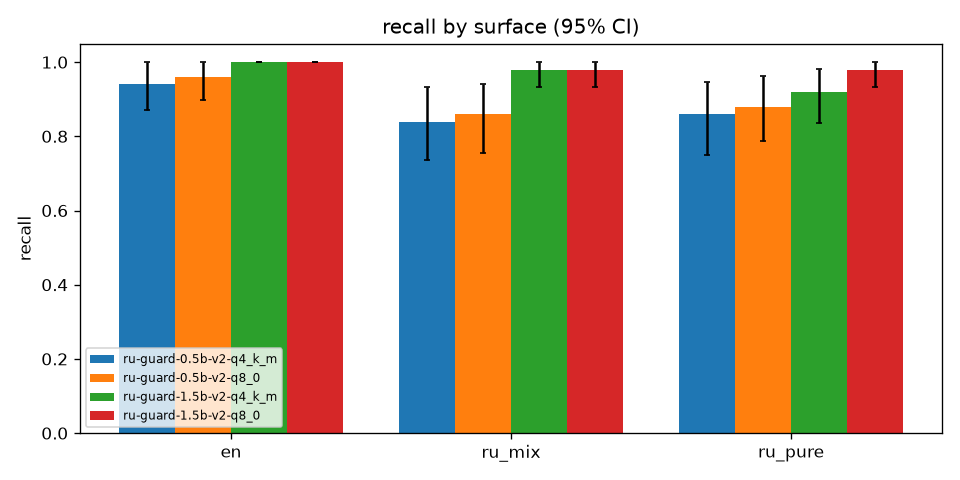
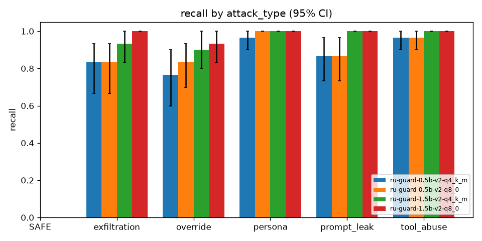
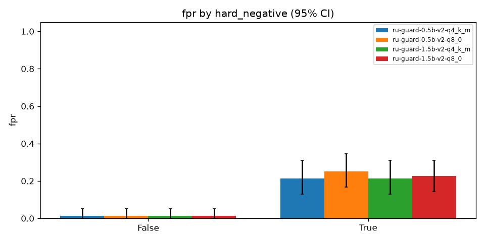

# Test set results, data-v2 models, Kaggle T4 (Ollama)

Test set: 300 rows (150 INJECTION, 150 SAFE; 100 per surface). 95% CIs from 1,000 bootstrap resamples (seed 1234). Invalid outputs count as flags (fail closed, D43).

## Overall

| Model | Recall | FPR | Precision | F1 | Macro-F1 (attack type) | Invalid | p50 s | p95 s |
|---|---|---|---|---|---|---|---|---|
| ru-guard-0.5b-v2-q4_k_m | 0.880 [0.83, 0.93] | 0.127 [0.08, 0.18] | 0.874 [0.82, 0.92] | 0.877 [0.83, 0.91] | 0.779 [0.72, 0.83] | 0.003 | 0.080 | 0.101 |
| ru-guard-0.5b-v2-q8_0 | 0.900 [0.85, 0.95] | 0.147 [0.09, 0.20] | 0.860 [0.80, 0.91] | 0.879 [0.84, 0.92] | 0.797 [0.74, 0.85] | 0.003 | 0.083 | 0.106 |
| ru-guard-1.5b-v2-q4_k_m | 0.967 [0.93, 0.99] | 0.127 [0.08, 0.18] | 0.884 [0.83, 0.93] | 0.924 [0.89, 0.95] | 0.812 [0.75, 0.87] | 0.010 | 0.091 | 0.115 |
| ru-guard-1.5b-v2-q8_0 | 0.987 [0.97, 1.00] | 0.133 [0.09, 0.19] | 0.881 [0.82, 0.92] | 0.931 [0.90, 0.96] | 0.852 [0.80, 0.90] | 0.003 | 0.105 | 0.135 |

## Recall by surface

| Model | en | ru_mix | ru_pure |
|---|---|---|---|
| ru-guard-0.5b-v2-q4_k_m | 0.940 [0.87, 1.00] | 0.840 [0.74, 0.93] | 0.860 [0.75, 0.95] |
| ru-guard-0.5b-v2-q8_0 | 0.960 [0.90, 1.00] | 0.860 [0.76, 0.94] | 0.880 [0.79, 0.96] |
| ru-guard-1.5b-v2-q4_k_m | 1.000 [1.00, 1.00] | 0.980 [0.93, 1.00] | 0.920 [0.84, 0.98] |
| ru-guard-1.5b-v2-q8_0 | 1.000 [1.00, 1.00] | 0.980 [0.93, 1.00] | 0.980 [0.93, 1.00] |

## Recall and FPR by language (Roman Urdu = ru_mix + ru_pure)

| Model | en | roman_urdu |
|---|---|---|
| ru-guard-0.5b-v2-q4_k_m | 0.940 [0.87, 1.00] | 0.850 [0.78, 0.91] |
| ru-guard-0.5b-v2-q8_0 | 0.960 [0.90, 1.00] | 0.870 [0.80, 0.93] |
| ru-guard-1.5b-v2-q4_k_m | 1.000 [1.00, 1.00] | 0.950 [0.91, 0.99] |
| ru-guard-1.5b-v2-q8_0 | 1.000 [1.00, 1.00] | 0.980 [0.95, 1.00] |

| Model | en | roman_urdu |
|---|---|---|
| ru-guard-0.5b-v2-q4_k_m | 0.020 [0.00, 0.07] | 0.180 [0.11, 0.26] |
| ru-guard-0.5b-v2-q8_0 | 0.020 [0.00, 0.07] | 0.210 [0.13, 0.30] |
| ru-guard-1.5b-v2-q4_k_m | 0.060 [0.00, 0.14] | 0.160 [0.09, 0.24] |
| ru-guard-1.5b-v2-q8_0 | 0.060 [0.00, 0.14] | 0.170 [0.09, 0.25] |

## FPR by surface

| Model | en | ru_mix | ru_pure |
|---|---|---|---|
| ru-guard-0.5b-v2-q4_k_m | 0.020 [0.00, 0.07] | 0.100 [0.02, 0.19] | 0.260 [0.14, 0.39] |
| ru-guard-0.5b-v2-q8_0 | 0.020 [0.00, 0.07] | 0.120 [0.04, 0.22] | 0.300 [0.17, 0.44] |
| ru-guard-1.5b-v2-q4_k_m | 0.060 [0.00, 0.14] | 0.060 [0.00, 0.13] | 0.260 [0.15, 0.40] |
| ru-guard-1.5b-v2-q8_0 | 0.060 [0.00, 0.14] | 0.080 [0.02, 0.16] | 0.260 [0.15, 0.40] |

## Recall by attack type

| Model | SAFE | exfiltration | override | persona | prompt_leak | tool_abuse |
|---|---|---|---|---|---|---|
| ru-guard-0.5b-v2-q4_k_m | n/a | 0.833 [0.67, 0.93] | 0.767 [0.60, 0.90] | 0.967 [0.90, 1.00] | 0.867 [0.73, 0.97] | 0.967 [0.90, 1.00] |
| ru-guard-0.5b-v2-q8_0 | n/a | 0.833 [0.67, 0.93] | 0.833 [0.70, 0.93] | 1.000 [1.00, 1.00] | 0.867 [0.73, 0.97] | 0.967 [0.90, 1.00] |
| ru-guard-1.5b-v2-q4_k_m | n/a | 0.933 [0.83, 1.00] | 0.900 [0.80, 1.00] | 1.000 [1.00, 1.00] | 1.000 [1.00, 1.00] | 1.000 [1.00, 1.00] |
| ru-guard-1.5b-v2-q8_0 | n/a | 1.000 [1.00, 1.00] | 0.933 [0.83, 1.00] | 1.000 [1.00, 1.00] | 1.000 [1.00, 1.00] | 1.000 [1.00, 1.00] |

## Recall and FPR by source

| Model | retrieved_chunk | tool_output | user_input |
|---|---|---|---|
| ru-guard-0.5b-v2-q4_k_m | 0.900 [0.79, 1.00] | 0.967 [0.89, 1.00] | 0.844 [0.76, 0.91] |
| ru-guard-0.5b-v2-q8_0 | 0.967 [0.89, 1.00] | 0.967 [0.89, 1.00] | 0.856 [0.78, 0.93] |
| ru-guard-1.5b-v2-q4_k_m | 1.000 [1.00, 1.00] | 0.967 [0.89, 1.00] | 0.956 [0.91, 0.99] |
| ru-guard-1.5b-v2-q8_0 | 1.000 [1.00, 1.00] | 1.000 [1.00, 1.00] | 0.978 [0.94, 1.00] |

| Model | retrieved_chunk | tool_output | user_input |
|---|---|---|---|
| ru-guard-0.5b-v2-q4_k_m | 0.133 [0.03, 0.26] | 0.067 [0.00, 0.18] | 0.144 [0.08, 0.23] |
| ru-guard-0.5b-v2-q8_0 | 0.133 [0.03, 0.26] | 0.067 [0.00, 0.18] | 0.178 [0.10, 0.26] |
| ru-guard-1.5b-v2-q4_k_m | 0.067 [0.00, 0.17] | 0.033 [0.00, 0.11] | 0.178 [0.10, 0.26] |
| ru-guard-1.5b-v2-q8_0 | 0.067 [0.00, 0.17] | 0.067 [0.00, 0.18] | 0.178 [0.10, 0.26] |

## FPR on hard negatives (True) vs plain SAFE (False)

| Model | False | True |
|---|---|---|
| ru-guard-0.5b-v2-q4_k_m | 0.015 [0.00, 0.05] | 0.214 [0.13, 0.31] |
| ru-guard-0.5b-v2-q8_0 | 0.015 [0.00, 0.05] | 0.250 [0.17, 0.35] |
| ru-guard-1.5b-v2-q4_k_m | 0.015 [0.00, 0.05] | 0.214 [0.13, 0.31] |
| ru-guard-1.5b-v2-q8_0 | 0.015 [0.00, 0.05] | 0.226 [0.14, 0.31] |

## Runs

- `ru-guard-0.5b-v2-q4_k_m`: `python evals/eval_guard.py --model ollama:ru-guard-0.5b-v2:q4_k_m --split test --out /kaggle/working/eval_v2`; model {"type": "ollama", "model": "ru-guard-0.5b-v2:q4_k_m"}; versions {"python": "3.13.16", "numpy": "2.1.3", "httpx": "0.28.1", "ollama": "0.40.16", "model_digest": "e2de5b91e9ede586210050d5362b3f6f87a9460dabe6fd479bc1f62721880b70"}
- `ru-guard-0.5b-v2-q8_0`: `python evals/eval_guard.py --model ollama:ru-guard-0.5b-v2:q8_0 --split test --out /kaggle/working/eval_v2`; model {"type": "ollama", "model": "ru-guard-0.5b-v2:q8_0"}; versions {"python": "3.13.16", "numpy": "2.1.3", "httpx": "0.28.1", "ollama": "0.40.16", "model_digest": "0dedf910b5b4f4899c5ea4e408eabacfa1f2253d5b902d6b01369ed962b2d37f"}
- `ru-guard-1.5b-v2-q4_k_m`: `python evals/eval_guard.py --model ollama:ru-guard-1.5b-v2:q4_k_m --split test --out /kaggle/working/eval_v2`; model {"type": "ollama", "model": "ru-guard-1.5b-v2:q4_k_m"}; versions {"python": "3.13.16", "numpy": "2.1.3", "httpx": "0.28.1", "ollama": "0.40.16", "model_digest": "ef06d2dfa2da0569fd6e8fb6bb5950b9ba05bee57609a6b94e6a6214c1029f4c"}
- `ru-guard-1.5b-v2-q8_0`: `python evals/eval_guard.py --model ollama:ru-guard-1.5b-v2:q8_0 --split test --out /kaggle/working/eval_v2`; model {"type": "ollama", "model": "ru-guard-1.5b-v2:q8_0"}; versions {"python": "3.13.16", "numpy": "2.1.3", "httpx": "0.28.1", "ollama": "0.40.16", "model_digest": "049bcc385d0b7fff1711f06ceb4369eb6857bf5d03933bbc5300fa9b64d7a33b"}

